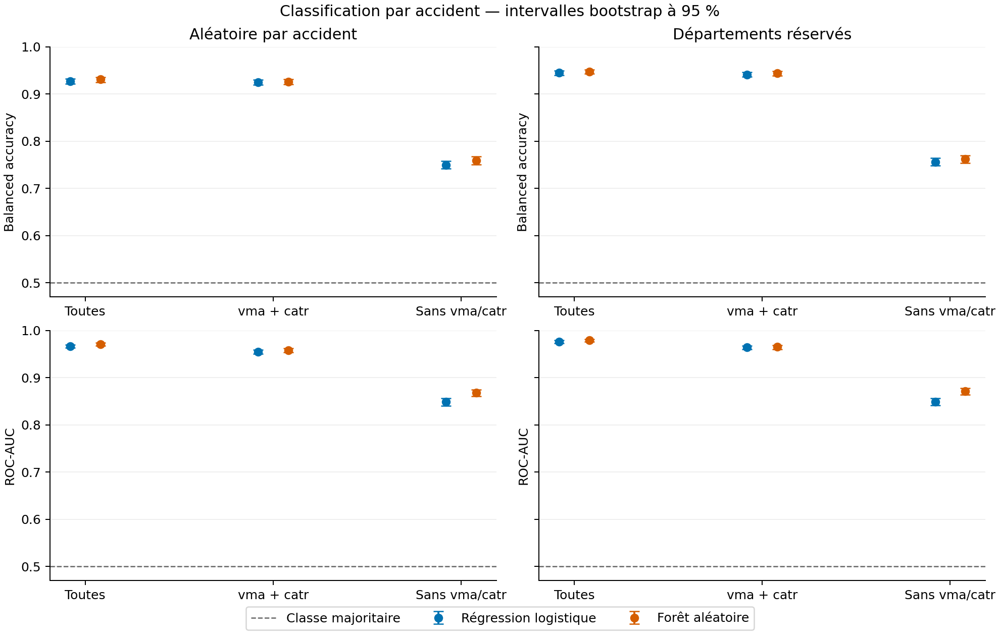

# Classification du contexte d’agglomération des accidents

**Biais d’évaluation, dépendance aux caractéristiques routières et généralisation géographique**

Projet de cours de **M1 mathématiques**, réalisé par **[Yaaaxin](https://github.com/Yaaaxin)** et **[zhailucc](https://github.com/zhailucc)**, à partir des données françaises **BAAC 2024**. L’extension méthodologique examine l’unité statistique, les variables routières et la validité d’une évaluation sur des départements absents de l’apprentissage. Elle ne revendique pas d’innovation algorithmique.

Le modèle classe un **accident déjà enregistré** comme survenu en ou hors agglomération (`agg`). Il ne prédit ni la survenue d’un accident, ni sa gravité. `vma` désigne la limite autorisée, pas la vitesse pratiquée.

## Auteurs / Contributions

| Auteur | Contributions établies |
|---|---|
| [Yaaaxin](https://github.com/Yaaaxin) | Coauteur du projet de cours ; création du dépôt et du commit initial. |
| [zhailucc](https://github.com/zhailucc) | Coauteur du projet de cours et collaborateur du dépôt. |

Le notebook initial ne précise pas la répartition individuelle du code et des analyses : ce travail est présenté comme une réalisation commune. L’extension méthodologique est identifiée séparément dans les fichiers et l’historique, sans réattribuer les contributions initiales.

## Question de recherche

Après séparation correcte des accidents, les performances et l’avantage éventuel de la forêt aléatoire sur la régression logistique reposent-ils surtout sur la limite de vitesse (`vma`) et la catégorie de route (`catr`) ? Ces constats persistent-ils sur des départements non vus pendant l’apprentissage ?

## Résultats mesurés

Une observation par accident, paramètres fixes, seuil 0,5. Le test aléatoire contient **10 881 accidents** ; le test géographique, **11 160**. Les identifiants sont disjoints entre train et test dans les deux cas ; les départements le sont également dans le second.

| Test | Variables | Modèle | Balanced accuracy | Macro-F1 | ROC-AUC |
|---|---|---|---:|---:|---:|
| Aléatoire | Toutes | Majorité | 0,5000 | 0,3847 | 0,5000 |
| Aléatoire | Toutes | Régression logistique | 0,9264 | 0,9304 | 0,9663 |
| Aléatoire | Toutes | Forêt | **0,9306** | 0,9339 | 0,9711 |
| Aléatoire | `vma + catr` | Forêt | 0,9258 | 0,9297 | 0,9581 |
| Aléatoire | Sans `vma/catr` | Forêt | 0,7589 | 0,7687 | 0,8675 |
| Géographique | Toutes | Majorité | 0,5000 | 0,3921 | 0,5000 |
| Géographique | Toutes | Régression logistique | 0,9450 | 0,9488 | 0,9760 |
| Géographique | Toutes | Forêt | **0,9474** | 0,9513 | 0,9788 |
| Géographique | `vma + catr` | Forêt | 0,9435 | 0,9477 | 0,9649 |
| Géographique | Sans `vma/catr` | Forêt | 0,7619 | 0,7713 | 0,8708 |

Les **18 évaluations**, leurs intervalles de confiance et les matrices de confusion figurent dans [le rapport détaillé](results/summary.md), [metrics.csv](results/metrics.csv) et [confusion_matrices.json](results/confusion_matrices.json). Aucun avertissement de convergence ; la régression logistique utilise au plus 289 des 3 000 itérations autorisées.



### Interprétation

- **Dépendance forte aux caractéristiques routières.** Retirer `vma/catr` diminue la balanced accuracy de la forêt de **0,1716** sur le test aléatoire (IC 95 % **[0,1620 ; 0,1807]**) et de **0,1855** sur le test géographique (**[0,1766 ; 0,1943]**). Les autres variables conservent une information prédictive, mais les deux variables routières suffisent déjà à approcher le score complet.
- **Avantage de la forêt limité.** Avec toutes les variables, son gain de balanced accuracy sur la logistique vaut **0,0042 [0,0015 ; 0,0068]** en aléatoire. En géographique, le gain **0,0024 [−0,0005 ; 0,0053]** reste incertain. Son gain de ROC-AUC y est positif : **0,0028 [0,0009 ; 0,0047]**. Le classement des modèles dépend donc de la métrique.
- **Pas de dégradation sur les départements choisis.** Les scores géographiques sont ici plus élevés. Les deux tests portent sur des ensembles différents, avec respectivement 62,51 % et 64,49 % d’accidents en agglomération ; ce n’est pas la preuve que le transfert améliore un modèle ni qu’il réussira sur tout autre territoire.
- **Une association n’est pas une fuite en soi.** `vma/catr` décrivent fortement le contexte d’agglomération. L’ablation mesure cette dépendance ; elle n’établit ni une fuite de cible, ni une cause d’accident. La fuite documentée dans le projet initial concerne le partage des mêmes accidents entre apprentissage et test.

Les IC proviennent de **1 000 bootstrap appariés au niveau accident**, à modèles fixés. Ils ne couvrent pas l’incertitude de réentraînement ou du choix des départements, et n’éliminent pas la dépendance spatiale. Les comparaisons sont exploratoires, sans correction pour multiplicité.

## Méthode et corrections

Les **54 402 accidents** de `caract` correspondent à **70 248 descriptions** dans `lieux`. Pour 15 645 accidents, plusieurs lignes existent : prendre la première imposerait un choix sans justification. Les catégories routières sont agrégées en proportions ; les limites de vitesse et nombres de voies sont résumés par médiane, minimum, maximum et proportion manquante. Chaque accident a ainsi exactement le même poids. Cette représentation conserve les différences entre lieux sans prétendre reconstruire le lieu principal.

Les codes inconnus et valeurs hors domaine sont traités explicitement ; les zéros valides sont préservés. Les catégories sont encodées sans ordre artificiel et les heures/dates par composantes cycliques et jour de semaine. Imputation, encodage et mise à l’échelle sont ajustés **sur le train uniquement, dans des Pipeline**. `agg` reste la cible, `Num_Acc` un identifiant, et `dep` sert exclusivement au découpage territorial.

Les graines, les 22 départements réservés et les hyperparamètres ont été fixés avant les expériences, sans sélection selon les scores. Aucun réglage d’hyperparamètres n’a été réalisé. Voir [le protocole](docs/protocol.md), [la configuration](config/experiment.json) et [les données](data/README.md).

## Reproduire

Depuis la racine du dépôt, avec Python **3.13** (exécution de référence : **3.13.5**, Windows) :

```bash
python -m venv .venv
# Windows PowerShell : .venv\Scripts\Activate.ps1
# Linux/macOS : source .venv/bin/activate
python -m pip install -r requirements.txt
python -m src.download_data
python -m unittest discover -s tests -v
python -m src.experiment
python -m src.report
```

Les versions directes sont fixées dans `requirements.txt` ; les versions effectivement utilisées et les hachages sont dans [run_metadata.json](results/run_metadata.json). L’environnement local `.conda` n’est pas nécessaire. L’expérience utilise un seul thread de forêt pour rester compatible avec les restrictions de files parallèles Windows. Les commandes ne dépendent pas du répertoire personnel de l’auteur.

Validation : **8 tests réussis**, 18 jeux de métriques et matrices recalculés depuis les prédictions, hachages des sources/données contrôlés. Les 6 cellules de code du notebook méthodologique ont été exécutées séquentiellement avec IPython ; le lancement d’un noyau Jupyter séparé reste non validé dans l’environnement Windows utilisé, en raison des permissions de son fichier de connexion.

Pour lire la démarche et examiner les tableaux, ouvrir [02_methodologie.ipynb](notebooks/02_methodologie.ipynb) dans un éditeur Jupyter. Ses cellules lisent les résultats agrégés ; les commandes ci-dessus refont les entraînements. Une nouvelle exécution remplace les résultats du même répertoire ; `python -m src.experiment --output .local/reproduction` permet une comparaison séparée.

## Travail initial, données et limites

- [01_accidents_ml.ipynb](notebooks/01_accidents_ml.ipynb) conserve le code initial du cours, clairement marqué comme archive. [La note historique](docs/original-project.md) détaille les corrections et les scores anciens, **non validés** : 5 050 accidents partagés, soit 36,08 % des lignes test provenant d’accidents déjà vus. La différence entre anciens et nouveaux scores ne mesure pas isolément l’effet de ce biais.
- [BAAC 2024, ONISR / Ministère de l’intérieur](https://www.data.gouv.fr/datasets/53698f4ca3a729239d2036df), Licence Ouverte / Open Licence. Les deux fichiers locaux sont identiques aux ressources officielles selon SHA-256 ; téléchargement initial de date inconnue. Les données brutes, adresses, coordonnées et prédictions individuelles restent hors du dépôt. Voir [les sources et conditions](data/README.md).
- Une année et un seul ensemble de départements réservés : pas de validation temporelle ni de garantie nationale. L’enregistrement des lieux multiples et les erreurs de saisie peuvent affecter les résultats. L’agrégation perd les associations entre caractéristiques d’un même lieu. Les seuils de plausibilité et le codage cyclique du jour du mois sont des choix de modélisation à discuter, pas des corrections officielles.
- Sans observations hors accident ni mesure d’exposition au trafic, aucune conclusion sur la probabilité ou les causes d’un accident n’est permise. L’utilisation est descriptive et pédagogique.

La licence des données ne s’étend pas automatiquement au code et aux documents du projet ; aucune licence de code n’est attribuée unilatéralement aux contributions communes.
