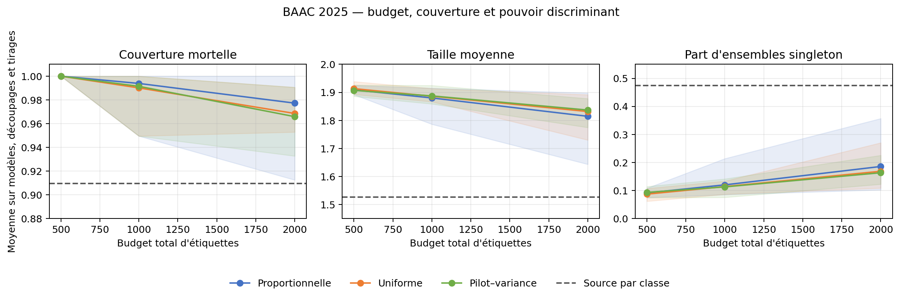

# Calibration d'accidents mortels sous décalages spatio-temporels

Projet de cours de **M1 mathématiques** réalisé par **[Yaaaxin](https://github.com/Yaaaxin)** et **[zhailucc](https://github.com/zhailucc)** à partir des données françaises BAAC. La branche `research-v2` prolonge le projet initial par une étude méthodologique :

> Comment répartir un budget limité d'étiquettes locales, après transfert vers une nouvelle année et de nouveaux départements, pour couvrir la classe mortelle et les régions sans perdre tout pouvoir discriminant ?

L'étude combine des méthodes existantes de prédiction conforme, une validation spatio-temporelle et une hypothèse d'allocation. Elle ne revendique pas d'innovation algorithmique. Elle classe le caractère mortel **parmi les accidents corporels déjà enregistrés** ; elle ne prédit ni la survenue d'un accident ni une cause de décès.

## Résultat principal

Le protocole utilise BAAC 2019–2024 pour la validation et le choix des règles, puis BAAC 2025 comme année indépendante. Les départements cibles sont absents de l'apprentissage. Le pool d'adaptation et le test 2025 ont été séparés par identifiant avant lecture des étiquettes ; le [gel du protocole](research_v2/freeze.json) précède l'[ouverture finale](research_v2/results/final_access_receipt.json).

Les moyennes 2025 portent sur trois découpages géographiques et les deux modèles ; pour les allocations locales, elles incluent aussi trois tirages de calibration.

| Méthode | Budget local | Couverture globale | Couverture mortelle | Taille moyenne | Ensembles singleton |
|---|---:|---:|---:|---:|---:|
| Source pooled | 0 | 0,907 | **0,000** | 0,953 | 0,953 |
| Source pondérée corrigée | 0 | 0,903 | **0,000** | 0,949 | 0,949 |
| Source conditionnelle à la classe | 0 | 0,910 | 0,910 | **1,524** | **0,476** |
| Locale proportionnelle, département × classe | 2 000 | 0,904 | **0,976** | 1,812 | 0,188 |
| Locale uniforme, département × classe | 2 000 | 0,903 | 0,969 | 1,832 | 0,168 |
| Locale pilot–variance, département × classe | 2 000 | 0,902 | 0,966 | 1,836 | 0,164 |

La couverture globale masque ici une défaillance complète de la classe rare : les calibrations source pooled et pondérée ne couvrent aucun accident mortel des tests 2025. La calibration source par classe restaure une couverture mortelle proche de 90 % avec les ensembles les plus compacts parmi les méthodes qui protègent cette classe.

Les étiquettes locales augmentent la couverture mortelle, mais les cellules département × décès restent rares. À budget 500, presque tous les seuils mortels sont infinis et les ensembles contiennent presque toujours les deux classes. À budget 2 000, ils commencent à se contracter sans devenir aussi compacts que la référence source par classe.

La règle candidate pilot–variance n'a pas de bénéfice stable. Ce résultat négatif est conservé. Un [audit postérieur](research_v2/results/audit/report.md) a corrigé la baseline pondérée, ajouté les couvertures mortelles macro-départementales et comparé les granularités sur les mêmes labels. Les résultats originaux restent archivés dans le [rapport gelé](research_v2/results/report.md).



## Amendement d'audit

Les résultats 2025 avaient déjà été publiés lors de cet amendement. Le protocole et les expériences 2019–2024 ont donc été [gelés séparément](research_v2/audit_freeze.json) avant toute nouvelle exécution 2025 ; les nouvelles valeurs sont explicitement des corrections postérieures, non une seconde validation indépendante.

L'audit établit trois points. Premièrement, la baseline pondérée utilisait une distribution source mal alignée : sa couverture 2025 corrigée vaut 0,903 au lieu de 0,887, mais sa couverture mortelle reste nulle. Deuxièmement, le contrôle de même domaine obtient lui aussi une couverture mortelle nulle ; ce phénomène provient de la garantie marginale pooled et de la rareté de la classe, pas nécessairement du transfert. Troisièmement, cinq labels pilot par département ne contiennent aucun décès dans 63,5 % des tirages historiques. Les calibrations département × classe gagnent en couverture régionale principalement en produisant des ensembles plus grands, souvent complets.

Le [rapport d'audit](research_v2/results/audit/report.md) présente les conclusions maintenues ou modifiées, la correction du rapport de densités, les oracles historiques non déployables et la simulation séparant effet régional partagé et changement de loi conditionnelle.

## Méthode

L'étiquette accident est construite uniquement à partir de `Usagers.grav` : au moins une personne enregistrée tuée dans les trente jours. Une gravité inconnue n'est jamais assimilée à une absence de décès. Usagers n'alimente aucune variable du prédicteur.

Les variables décrivent le contexte de l'accident : temps, luminosité, atmosphère, agglomération, intersection et caractéristiques routières. Identifiants, département, adresse, coordonnées, type de collision et informations sur les victimes sont exclus du modèle. Les lignes multiples de Lieux sont agrégées à l'accident sans choisir arbitrairement la première.

Deux prédicteurs fixes sont comparés : régression logistique et gradient boosting sur histogrammes. Imputation, encodage et standardisation sont ajustés dans une `Pipeline` sur l'apprentissage uniquement. Une calibration de Platt distincte produit les probabilités. Les trois situations d'accès à la cible sont : aucune donnée cible, caractéristiques cibles sans étiquette, puis 500, 1 000 ou 2 000 étiquettes locales.

La calibration conforme utilise α=0,10. Un quantile département × classe n'est fini qu'à partir de neuf observations de cette classe. Le pilot de cinq labels par département est payé dans le budget et n'est pas réutilisé dans les quantiles. Les hypothèses, la dérivation du critère substitutif et ses limites sont détaillées dans [theory.md](research_v2/theory.md).

## Reproduire

Environnement de référence de research-v2 : Python 3.13.5. L'amendement d'audit a été exécuté avec Python 3.14.3, NumPy 2.4.2, Pandas 3.0.1 et scikit-learn 1.8.0. Tous les calculs sont séquentiels avec `n_jobs=1`.

```bash
python -m venv .venv
# Windows PowerShell : .venv\Scripts\Activate.ps1
# Linux/macOS : source .venv/bin/activate
python -m pip install -r requirements.txt

python -m research_v2.download
python -m research_v2.data
python -m unittest discover -s tests -v
python -m research_v2.simulation
python -m research_v2.run pilot
python -m research_v2.run development
python -m research_v2.run final
python -m research_v2.report

# Amendement postérieur à research-v2
python -m research_v2.audit development
python -m research_v2.audit_simulation
python -m research_v2.audit corrected_2025
python -m research_v2.audit_report
python -m research_v2.audit_pack pack
python -m research_v2.audit_validate
```

Les exécutions écrivent des checkpoints dans `research_v2/private/` afin de reprendre après interruption. Ce répertoire, les données brutes et les prédictions par accident sont exclus de Git. Les résultats publics sont agrégés. Les empreintes des entrées et sorties de référence figurent dans le manifeste, le gel et les métadonnées d'exécution.

Les grands CSV de l'amendement sont publiés en `csv.gz`. `audit_pack` vérifie que leur décompression, et la concaténation chronologique des trois partitions départementales, redonnent exactement les SHA-256 du gel.

Le notebook [03_research_v2.ipynb](notebooks/03_research_v2.ipynb) présente en français le problème, le protocole et les résultats. Il lit les tableaux agrégés ; les commandes ci-dessus refont les modèles.

## Documents

- [Comparaison de dix publications primaires](research_v2/literature.md), avec vérification du DOI `10.1080/15389588.2025.2538725`.
- [Protocole expérimental](research_v2/protocol.md), [données et intégrité](research_v2/data.md), [dérivation mathématique](research_v2/theory.md).
- [Audit avant gel](research_v2/results/data_audit_before_freeze.json), [simulation contrôlée](research_v2/results/simulation_summary_clean.csv), [résultats régionaux 2025](research_v2/results/final/departments.csv).
- [Amendement d'audit](research_v2/audit_protocol.md), [gel de l'amendement](research_v2/audit_freeze.json), [rapport corrigé](research_v2/results/audit/report.md) et [métriques 2025 corrigées](research_v2/results/audit/corrected_2025/metrics.csv).

## Données, licence et limites

Les 21 CSV proviennent du jeu officiel [BAAC 2005–2025](https://www.data.gouv.fr/datasets/53698f4ca3a729239d2036df/), sous [Licence Ouverte 2.0](https://www.data.gouv.fr/datasets/licence-ouverte-2-0). Les données brutes ne sont pas publiées dans ce dépôt. Le [manifeste research-v2](research_v2/data_manifest.json) contient les URL, identifiants de ressource, tailles, SHA-256 et contrôles d'empreinte disponibles. La date de téléchargement des données du projet initial demeure inconnue ; celles de research-v2 sont enregistrées précisément.

Les résultats 2025 décrivent une adaptation rétrospective au sein d'une même année. Ils supposent une stabilité entre pool d'adaptation et test qui n'est pas démontrée et ne garantissent pas un transfert vers 2026. Quarante-deux des 58 couples découpage–département ont moins de vingt accidents mortels dans le test ; les couvertures locales sont donc souvent imprécises. La dépendance spatiale est examinée par rééchantillonnage des départements, sans être éliminée.

BAAC est une base administrative brute, avec erreurs de saisie et usagers potentiellement manquants. Les résultats ne couvrent pas les décès non enregistrés ni les accidents dont la gravité reste indéterminée. Aucune importance ou association prédictive n'est interprétée comme cause d'un accident ou d'un décès.

## Auteurs / Contributions

| Auteur | Contributions établies par les matériaux du dépôt |
|---|---|
| [Yaaaxin](https://github.com/Yaaaxin) | Coauteur du projet de cours ; création du dépôt et du commit initial. |
| [zhailucc](https://github.com/zhailucc) | Coauteur du projet de cours et collaborateur du dépôt. |

Le notebook initial ne documente pas une répartition individuelle plus précise. Le projet original est donc présenté comme un travail commun ; aucune attribution détaillée n'est inventée pour research-v2.

## Version initiale conservée

Le premier sujet, « Classification du contexte d'agglomération des accidents », reste entièrement disponible : [notebook original](notebooks/01_accidents_ml.ipynb), [extension méthodologique v1](notebooks/02_methodologie.ipynb), [résultats v1](results/summary.md), [protocole v1](docs/protocol.md) et [note historique](docs/original-project.md). L'historique Git conserve le commit v1 sur `main` ; research-v2 est développé sur une branche distincte.

La licence des données ne s'étend pas automatiquement au code et aux documents du projet ; aucune licence de code n'est attribuée unilatéralement aux contributions communes.
