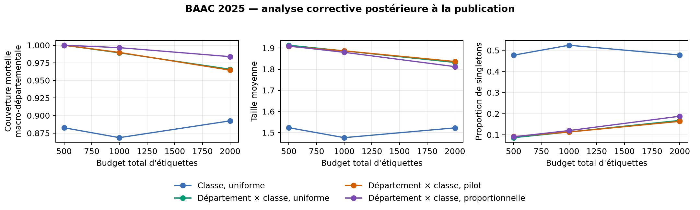
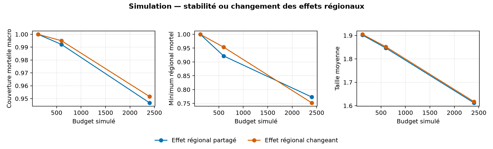

# Audit ciblé de research-v2

## Statut et portée

Cet audit corrige et complète `research-v2` sans modifier son gel, son rapport ni ses résultats originaux. La version publiée avant l'audit est le commit [`3523444`](https://github.com/Yaaaxin/projet-accidents-ml/commit/35234446432e71b877728ab59ed15685f1e4fd7e). Les résultats BAAC 2025 étaient donc déjà connus. Le [protocole d'amendement](../../audit_protocol.md), les expériences historiques et leur [gel avec empreintes](../../audit_freeze.json) ont été fixés avant la nouvelle exécution 2025. Celle-ci constitue une **analyse corrective postérieure à la publication**, et non une nouvelle validation préenregistrée.

Les choix de méthode reposent sur BAAC 2019–2024 : entraînement roulant sur les années antérieures, validation cible en 2022, 2023 et 2024, trois découpages géographiques et deux modèles. Les comparaisons locales ajoutent trois graines d'acquisition. Les valeurs 2025 servent uniquement à mesurer les conséquences des corrections déjà fixées.

## 1. Rapport de densités corrigé

L'implémentation originale estimait la distribution source du classifieur de domaine sur `fit`, composé d'années plus anciennes, puis appliquait les poids aux scores de `conformal`, issus de la dernière année source. Le rapport estimé ne correspondait donc pas à la distribution des observations effectivement pondérées.

La correction estime le rapport sur `tuning` et le pool cible d'adaptation. `tuning` et `conformal` sont des partitions par hachage disjointes de la même année et des mêmes départements sources. L'estimation est indépendante des scores conformes auxquels les poids sont appliqués, tout en restant alignée sur leur distribution source. Le pool cible intervient sans étiquette. Les poids sont toujours estimés puis tronqués entre 0,1 et 10 : la garantie théorique du rapport connu ne s'applique pas exactement.

| Période | Version | Couverture | Couverture mortelle | Taille moyenne | Singleton |
|---|---|---:|---:|---:|---:|
| 2022–2024 | Originale, source=`fit` | 0,8966 | 0,0000 | 0,9421 | 0,9421 |
| 2022–2024 | Corrigée, source=`tuning` | **0,9098** | 0,0000 | 0,9585 | 0,9585 |
| 2025 | Originale | 0,8870 | 0,0000 | 0,9299 | 0,9299 |
| 2025, post-publication | Corrigée | **0,9032** | 0,0000 | 0,9488 | 0,9488 |

Le chiffre 2025 de 0,887 ne doit plus être utilisé comme résultat de la baseline pondérée. La correction augmente la couverture de 0,0161 et la taille de 0,0190. Elle ne restaure aucune couverture de la classe mortelle.

## 2. Le zéro de couverture pooled n'est pas créé par le transfert

Le contrôle de même domaine calibre sur `conformal` et teste sur `tuning`, deux sous-échantillons indépendants de la même année source. Sa couverture moyenne vaut 0,9004 en développement et 0,9035 dans les scénarios associés à 2025, mais sa couverture mortelle vaut 0 dans les deux cas. La source pooled sur les domaines cibles donne également une couverture mortelle nulle.

Ce résultat change l'explication, pas le constat : le transfert géographique ou temporel n'est pas nécessaire pour obtenir zéro. Une garantie pooled à 90 % est marginale ; lorsque les accidents non mortels dépassent 90 %, elle peut atteindre sa cible en excluant presque systématiquement la classe rare. La calibration par classe est le contrôle pertinent : en 2025 elle donne 0,9096 de couverture mortelle, une taille de 1,5243 et 0,4757 de singletons.

## 3. Information locale et granularité de calibration

Pour chaque politique, budget, graine, modèle et découpage, les calibrations pooled, par classe et département × classe utilisent exactement les mêmes accidents acquis. Les hachages enregistrés ont une seule valeur par comparaison. L'écart ci-dessous isole donc la granularité du quantile, pas un changement d'échantillon.

| Calibration locale 2025 | Budget | Couverture | Couverture mortelle macro-départementale | Taille | Singleton |
|---|---:|---:|---:|---:|---:|
| Uniforme, pooled | 2 000 | 0,9312 | 0,0055 | 0,9850 | 0,9806 |
| Uniforme, par classe | 2 000 | 0,9329 | 0,8924 | 1,5222 | 0,4778 |
| Uniforme, département × classe | 2 000 | 0,9029 | **0,9658** | 1,8320 | 0,1680 |

Le quantile par classe utilise l'information locale sans fragmentation régionale. Le croisement département × classe augmente la couverture régionale mortelle, mais au prix d'ensembles beaucoup moins discriminants. À budget 500, sa couverture mortelle vaut 1, sa taille 1,9135 et seuls 8,65 % des ensembles sont des singletons : il renvoie presque toujours les deux classes.

À budget 2 000, les départements test contiennent en moyenne de 5 à 31 décès selon les scénarios, avec une médiane de 15,2. Pour l'uniforme département × classe, le décile, la médiane et le neuvième décile des couvertures mortelles départementales valent en moyenne 0,881, 1 et 1 ; 11,8 cellules mortelles sur environ 20 ont encore un seuil infini. Ces couvertures élevées ne doivent donc pas être lues sans la taille et le taux de singletons.



## 4. Allocation et objectif régional

Le critère candidat donne le même poids aux départements. L'indicateur principal correspondant est la moyenne non pondérée des couvertures mortelles départementales parmi les départements ayant au moins un décès test. Les quantiles régionaux et les effectifs sont publiés dans `regional_fatal_summary.csv`; la couverture mortelle agrégée reste secondaire.

| Allocation département × classe | Budget | Période | Couverture | Mortelle macro | Taille | Singleton |
|---|---:|---|---:|---:|---:|---:|
| Proportionnelle | 2 000 | 2022–2024 | 0,9073 | **0,9855** | 1,8300 | 0,1700 |
| Uniforme | 2 000 | 2022–2024 | 0,9060 | 0,9646 | 1,8211 | 0,1789 |
| Pilot–variance | 2 000 | 2022–2024 | 0,9051 | 0,9614 | **1,8172** | **0,1828** |
| Proportionnelle | 2 000 | 2025 post-publication | 0,9040 | **0,9838** | **1,8122** | **0,1878** |
| Uniforme | 2 000 | 2025 post-publication | 0,9029 | 0,9658 | 1,8320 | 0,1680 |
| Pilot–variance | 2 000 | 2025 post-publication | 0,9023 | 0,9646 | 1,8363 | 0,1637 |

La règle pilot–variance ne montre toujours pas de gain stable. La proportionnelle présente ici une couverture macro plus élevée et des ensembles au moins aussi compacts en 2025 ; cette observation était déjà visible en développement. Elle ne constitue pas une preuve d'optimalité générale, notamment parce que les découpages se recouvrent et que les petites cellules rendent les comparaisons instables.

## 5. Pourquoi le pilot ne gagne pas

### Identification avec cinq labels

Les 1 080 tirages « graine × scénario × département » historiques contiennent en moyenne 0,456 décès parmi cinq labels. Dans 63,5 % des cas, aucun décès n'est observé. L'erreur absolue moyenne du taux postérieur par rapport au taux complet du pool vaut environ 0,046 en taux brut. Le lissage vers le taux historique évite les zéros numériques, mais laisse peu d'information régionale propre.

### Coût du pilot

Le pilot acquiert en moyenne 97,2 labels, exclus des quantiles conformément au protocole. Il laisse environ 402, 902 et 1 901 labels de calibration connus aux budgets 500, 1 000 et 2 000. Le coût représente donc approximativement 19 %, 10 % et 5 % du budget nominal, avant même l'exclusion des gravités indéterminées.

L'oracle historique `oracle_variance_costed`, qui connaît les taux mais paie le même pilot, est comparé à `oracle_variance`, qui consacre tout le budget à la calibration. Les différences moyennes de couverture mortelle macro sont 0 au budget 500, 0 au budget 1 000 et +0,0007 au budget 2 000 ; la taille augmente respectivement de 0,0052, 0,0019 et 0,0054. Le coût seul n'explique donc pas l'absence de gain.

### Critère asymptotique et seuil fini

À niveau `α`, le quantile de split conformal est fini si

`ceil((n + 1)(1 − α)) ≤ n`, soit `n ≥ (1 − α)/α`.

Pour `α=0,10`, il faut au moins neuf décès de calibration dans chaque département. Le substitut de variance `Σ 1/(n_g p_g)` est continu et conduit, sans bornes, à `n_g ∝ 1/√p_g`. Il ne représente pas la discontinuité entre huit décès, où le seuil est infini, et neuf décès, où il devient fini.

L'oracle explicatif `oracle_equal_fatal` alloue plutôt selon `1/p_g`. Au budget 2 000 en développement, sa couverture mortelle macro vaut 0,9855 contre 0,9700 pour `oracle_variance`, mais sa taille est plus grande (1,8483 contre 1,8291), son taux de singletons plus faible (0,1517 contre 0,1709) et il conserve davantage de cellules mortelles infinies (15,6 contre 12,2). Il suralloue certaines cellules extrêmement rares sans leur faire franchir le seuil et prive des cellules intermédiaires. Ni le substitut asymptotique ni l'égalisation naïve des décès attendus ne résout donc le régime fini. Ces oracles utilisent toutes les étiquettes historiques et ne sont pas déployables.

## 6. Simulation : dépendance ou dérive conditionnelle

La simulation amendée distingue deux mécanismes :

- `shared_region_effect` : adaptation et test partagent le même intercept régional aléatoire. Conditionnellement à cet effet, la loi régionale est stable ; les accidents sont néanmoins dépendants marginalement par région ;
- `changed_region_effect` : les intercepts régionaux d'adaptation et de test sont tirés indépendamment. La loi conditionnelle change et la garantie régionale par échangeabilité n'est plus applicable.

Aux budgets 120 et 600, beaucoup de seuils mortels restent infinis : les couvertures proches de 1 reflètent surtout des ensembles de taille 1,85 à 2. Un point de pression simulé à 2 400 labels rend davantage de seuils finis. Pour l'allocation uniforme département × classe :

| Mécanisme, budget 2 400 | Couverture | Mortelle macro | Minimum régional mortel | Taille | Singleton |
|---|---:|---:|---:|---:|---:|
| Effet régional partagé | 0,9035 | 0,9467 | 0,7732 | 1,6125 | 0,3874 |
| Effet régional changeant | 0,9046 | 0,9516 | **0,7524** | 1,6174 | 0,3824 |

Le changement d'effet n'abaisse pas systématiquement la moyenne dans ces 100 répétitions ; il dégrade le minimum régional moyen et, surtout, invalide l'hypothèse qui justifierait une garantie par département. Ce résultat négatif est conservé : une dérive conditionnelle ne se détecte pas nécessairement par une baisse de la moyenne agrégée, particulièrement lorsque les ensembles restent larges.



## Conclusions révisées

Conclusions maintenues :

- la calibration pooled peut satisfaire la couverture globale tout en couvrant zéro accident mortel ;
- la calibration par classe est le compromis le plus compact parmi les méthodes protégeant explicitement la classe mortelle dans ces expériences ;
- les calibrations département × classe sont très conservatrices aux budgets étudiés ;
- aucune amélioration stable de pilot–variance n'est établie ;
- aucune importance prédictive ne doit être interprétée comme une cause de décès.

Conclusions modifiées ou précisées :

- le résultat pondéré original est numériquement invalide à cause du mauvais alignement de la distribution source ; la valeur 2025 corrigée est 0,9032, pas 0,8870 ;
- la couverture mortelle pooled nulle existe déjà sans décalage de domaine et ne doit pas être expliquée uniquement par le transfert ;
- l'évaluation de l'allocation doit privilégier la distribution des couvertures régionales, accompagnée des effectifs, de la taille des ensembles et du taux de singletons ;
- le manque d'information de cinq labels régionaux, le coût du pilot et l'inadéquation des objectifs continus au seuil de neuf décès sont trois mécanismes distincts ; aucun ne suffit seul à expliquer les résultats ;
- une dérive régionale peut supprimer la garantie théorique sans détériorer nettement la moyenne empirique.

## Limites

Les couvertures départementales reposent souvent sur peu de décès test. Les trois découpages géographiques se recouvrent et ne constituent pas 58 régions indépendantes. Le bootstrap par département décrit cette hétérogénéité sans supprimer l'autocorrélation spatiale. L'exclusion des gravités indéterminées de la calibration suppose implicitement que ce mécanisme ne crée pas une sélection défavorable ; cette hypothèse n'est pas démontrée. Les poids de densité sont estimés et tronqués. Les données 2025 ont été réanalysées après publication et ne peuvent servir à sélectionner une nouvelle méthode.

## Reproduction et preuves

```bash
python -m unittest discover -s tests -v
python -m research_v2.audit development
python -m research_v2.audit_simulation
# Vérifier research_v2/audit_freeze.json avant toute ouverture 2025.
python -m research_v2.audit corrected_2025
python -m research_v2.audit_report
python -m research_v2.audit_pack pack
python -m research_v2.audit_validate
```

Les résultats détaillés sont dans `development/`, `corrected_2025/` et `simulation/`. Les grands CSV sont compressés sans perte ; `packed_manifest.json` donne le SHA-256 de chaque archive et du contenu décompressé. Les tableaux compacts sont dans `tables/`. Les checkpoints, données brutes, étiquettes acquises par identifiant et prédictions individuelles restent exclus du dépôt.
