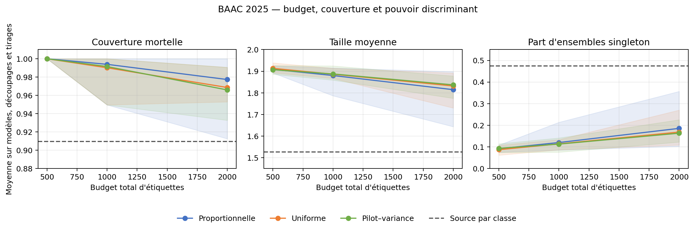

# Rapport research-v2

## Question et protocole

Cette extension étudie la classification d'un accident corporel enregistré comme mortel, sous transfert vers une nouvelle année et des départements absents de l'apprentissage. Elle demande comment répartir un budget d'étiquettes locales entre départements pour couvrir la classe mortelle et les régions tout en conservant des ensembles discriminants. Elle combine des méthodes connues ; elle ne revendique pas d'innovation algorithmique.

Le protocole a été fixé avec les années 2019–2024, puis gelé avant l'ouverture des étiquettes 2025. Trois découpages de vingt départements, deux modèles et trois graines d'acquisition sont conservés. Les résultats locaux ci-dessous moyennent donc 18 essais par budget et politique (3 découpages × 2 modèles × 3 graines).

## Résultats 2025

### Sans étiquette cible

| Méthode | Couverture | Couverture mortelle | Taille moyenne | Singleton | PR-AUC | Brier |
|---|---:|---:|---:|---:|---:|---:|
| Source pooled | 0,907 | 0,000 | 0,952 | 0,952 | 0,153 | 0,049 |
| Source pondérée | 0,887 | 0,000 | 0,930 | 0,930 | 0,153 | 0,049 |
| Source par classe | 0,911 | 0,910 | 1,526 | 0,474 | 0,153 | 0,049 |

Les méthodes pooled et pondérée atteignent une couverture globale proche de 0,9 mais une couverture mortelle nulle dans les six scénarios modèle × découpage. Cette défaillance est compatible avec une garantie marginale dominée par la classe non mortelle. L'utilisation des seules caractéristiques cibles pour estimer des poids ne corrige pas le problème. La calibration source par classe atteint une couverture mortelle moyenne de 0,910 avec une taille moyenne de 1,526.

### Étiquettes locales limitées

| Allocation | Budget | Couverture | Couverture mortelle | Taille moyenne | Singleton | Cellules mortelles à seuil infini |
|---|---:|---:|---:|---:|---:|---:|
| Proportionnelle | 500 | 0,921 | 1,000 | 1,909 | 0,091 | 19,3 |
| Uniforme | 500 | 0,926 | 1,000 | 1,913 | 0,087 | 19,3 |
| Pilot–variance | 500 | 0,919 | 1,000 | 1,907 | 0,093 | 19,3 |
| Proportionnelle | 1000 | 0,906 | 0,994 | 1,880 | 0,120 | 18,8 |
| Uniforme | 1000 | 0,908 | 0,990 | 1,886 | 0,114 | 17,8 |
| Pilot–variance | 1000 | 0,908 | 0,991 | 1,887 | 0,113 | 18,2 |
| Proportionnelle | 2000 | 0,904 | 0,977 | 1,815 | 0,185 | 14,4 |
| Uniforme | 2000 | 0,903 | 0,969 | 1,832 | 0,168 | 11,8 |
| Pilot–variance | 2000 | 0,902 | 0,966 | 1,837 | 0,163 | 12,0 |

À budget 500, la couverture mortelle vaut 1, mais presque toutes les cellules régionales mortelles ont un seuil infini : la classe mortelle est incluse par défaut et les ensembles sont proches de deux étiquettes. À budget 2000, la taille moyenne tombe entre 1,815 et 1,837, tandis que la couverture mortelle reste entre 0,966 et 0,977. Ce gain de couverture sur la référence source par classe est payé par des ensembles nettement plus grands.

### Hypothèse d'allocation

Sur 2019–2024, la règle pilot–variance comparée à l'uniforme donne en moyenne -0,0009 de couverture, -0,0011 de couverture mortelle et -0,0011 de taille. En 2025, les différences correspondantes sont -0,0022, -0,0005 et 0,0001. Elles changent de signe selon les budgets, modèles, régions et tirages. La règle candidate n'apporte donc pas de gain stable.

Par rapport à l'allocation proportionnelle en 2025, la règle candidate réduit en moyenne d'une unité le nombre de cellules mortelles à seuil infini, mais sa couverture mortelle diminue de 0,0046 et sa taille augmente de 0,0092. Ce compromis n'établit pas une amélioration.

## Hétérogénéité régionale et stabilité

Les trois découpages 2025 comprennent 58 couples découpage–département. 42 ont moins de vingt accidents mortels dans le test et 1 n'en a aucun. Les couvertures mortelles départementales de ces petites cellules sont descriptives. Les intervalles de chaque essai rééchantillonnent les départements entiers, mais les trois découpages se recouvrent.

Aucune étiquette test 2025 n'était indéterminée dans les départements évalués (0 exclusions sur les trois découpages). Les étiquettes indéterminées restent possibles dans les pools d'adaptation et leur acquisition est comptée dans le budget.

Le modèle de gradient boosting a une PR-AUC moyenne légèrement supérieure à la logistique en 2025. Ces valeurs dépassent la prévalence de la classe mortelle, mais restent faibles en valeur absolue : les probabilités discriminent modestement la classe rare. L'étude des ensembles porte sur la couverture ; elle ne transforme pas ce niveau de discrimination en prédiction causale ou opérationnelle.

## Simulation contrôlée

Sous échangeabilité, les méthodes conformes atteignent en moyenne le niveau visé ou deviennent conservatrices dans les petites cellules. Le scénario de rupture entre pool d'adaptation et test fait chuter la couverture locale à mesure que les seuils deviennent moins conservateurs : la grande taille des ensembles à faible budget peut masquer cette rupture. Les effets régionaux communs augmentent aussi la variabilité. Ces expériences valident les cas limites de l'implémentation ; elles ne prouvent pas les hypothèses sur BAAC.

## Conclusion

La question pratique n'est pas résolue par une allocation sophistiquée dans ce régime. Les cellules département × décès sont trop rares pour qu'un budget de 500 ou 1000 produise souvent des seuils informatifs. À 2000, les ensembles commencent à se contracter, mais la règle issue du pilot ne surpasse ni l'uniforme ni la proportionnelle de façon stable. La calibration source par classe offre ici le compromis le plus compact, avec une couverture mortelle proche de la cible plutôt qu'excessivement conservatrice.

Ces conclusions valent pour un partage rétrospectif au sein de BAAC 2025 et pour les départements fixés. Elles supposent une stabilité intradépartement entre adaptation et test qui n'est pas démontrée, ignorent les décès ou usagers non enregistrés, et ne généralisent pas automatiquement à 2026. Les variables décrivent des associations prédictives ; aucune importance de modèle n'est interprétée comme cause d'un décès.

## Fichiers de preuve

- [Protocole gelé](../protocol.md), [gel et empreintes](../freeze.json), [théorie](../theory.md) et [comparaison bibliographique](../literature.md).
- [Métriques 2025](final/metrics.csv), [résultats régionaux](final/departments.csv), [validation 2019–2024](development/metrics.csv), [comparaisons appariées](paired_allocation.csv) et [simulation](simulation_summary_clean.csv).
- [Audit des données avant gel](data_audit_before_freeze.json), [manifeste](../data_manifest.json), [partitions sans identifiants](../partitions.json) et [preuve d'ouverture finale](final_access_receipt.json).
